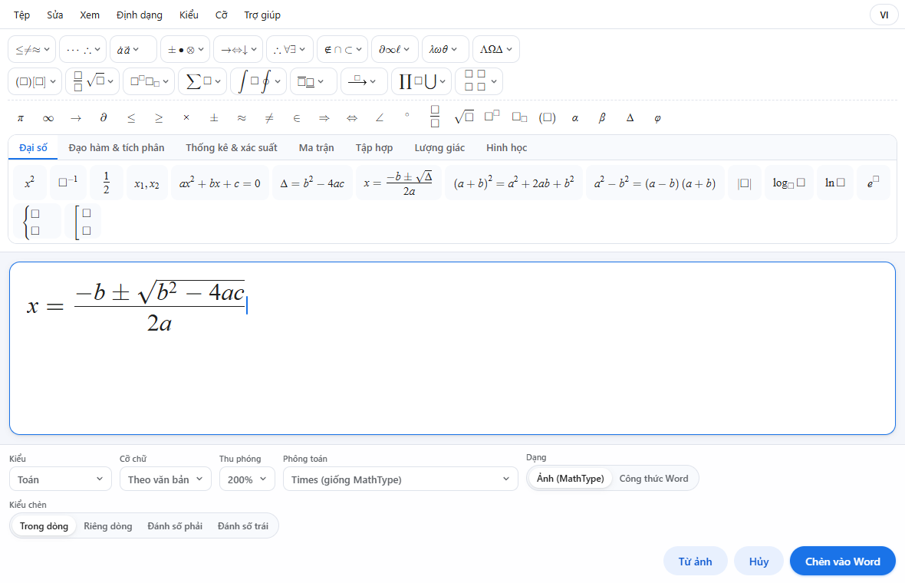
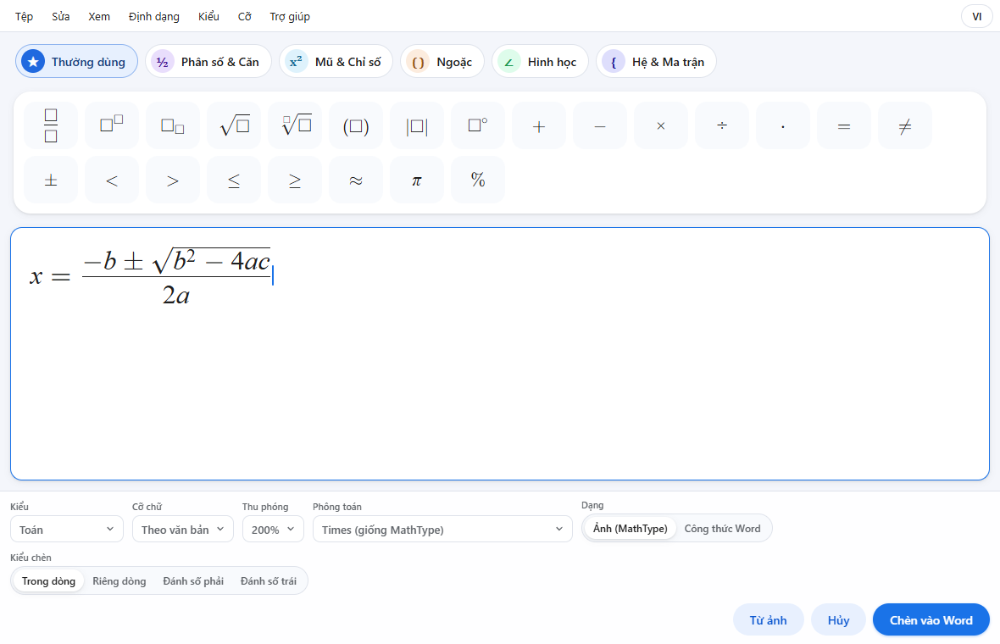
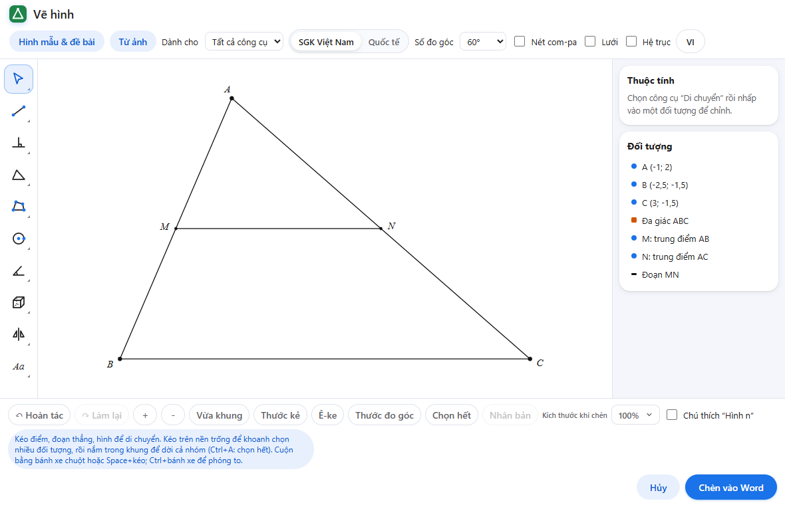
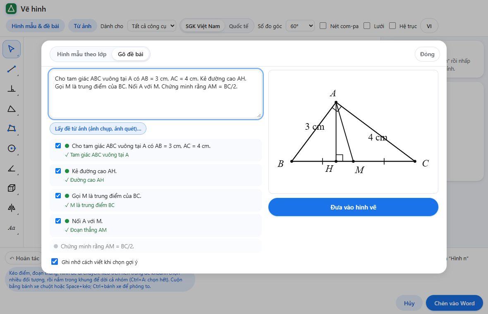
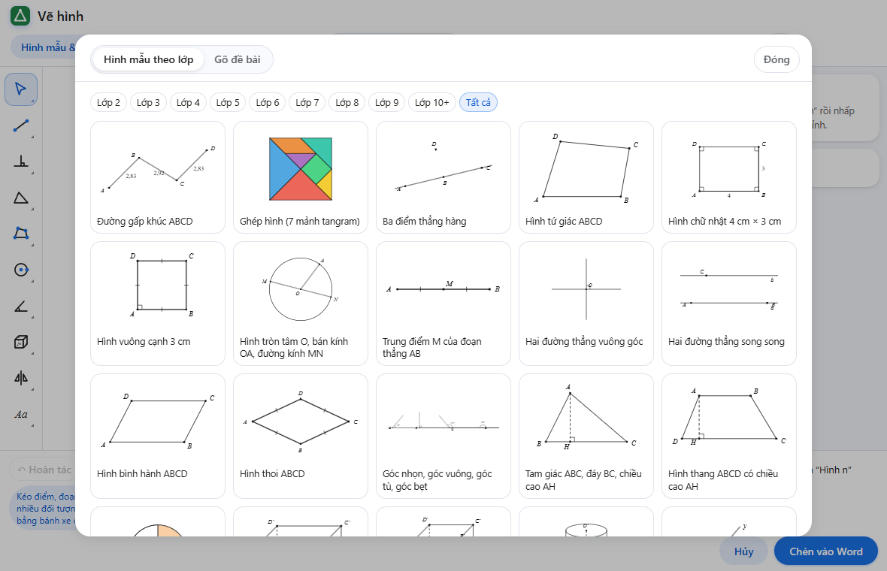
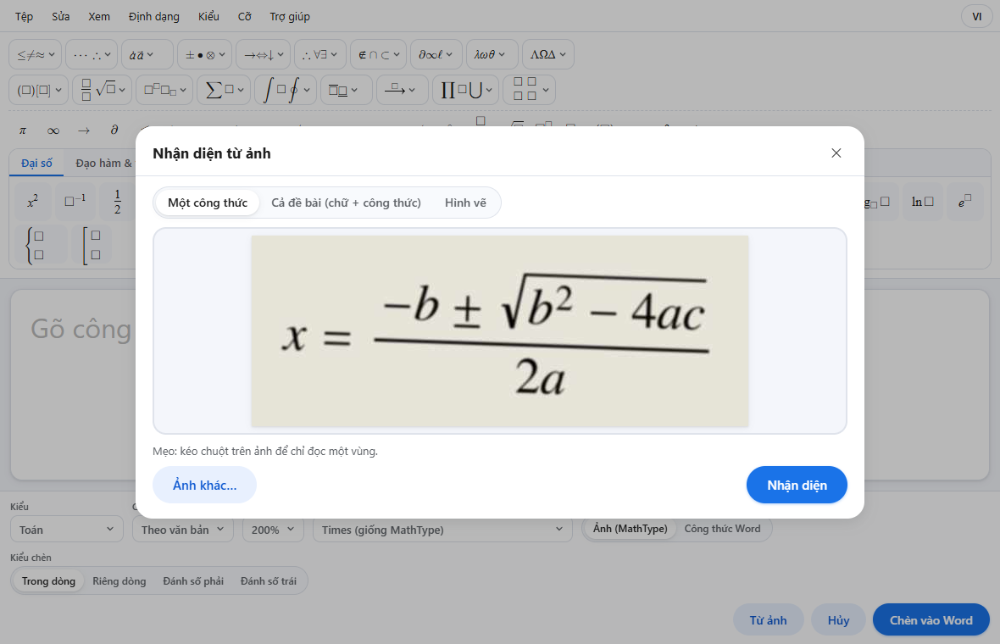
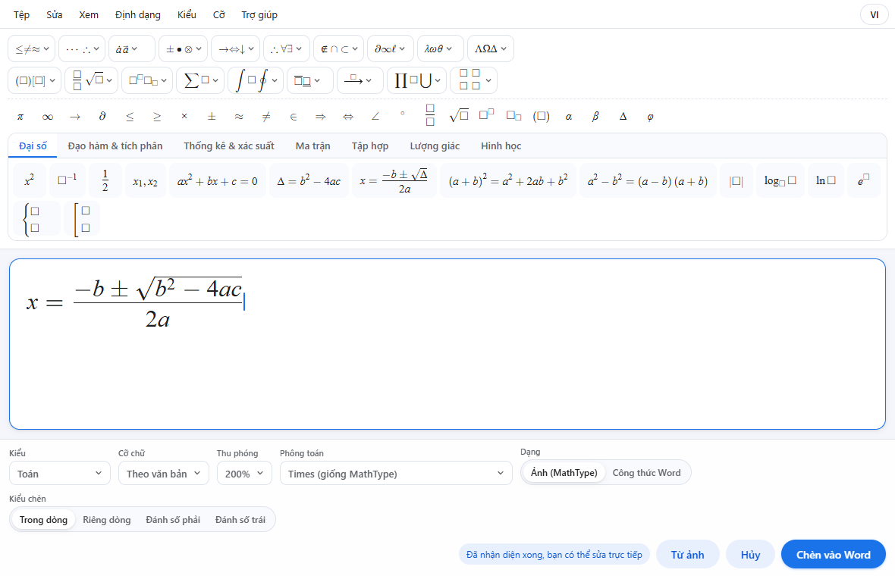
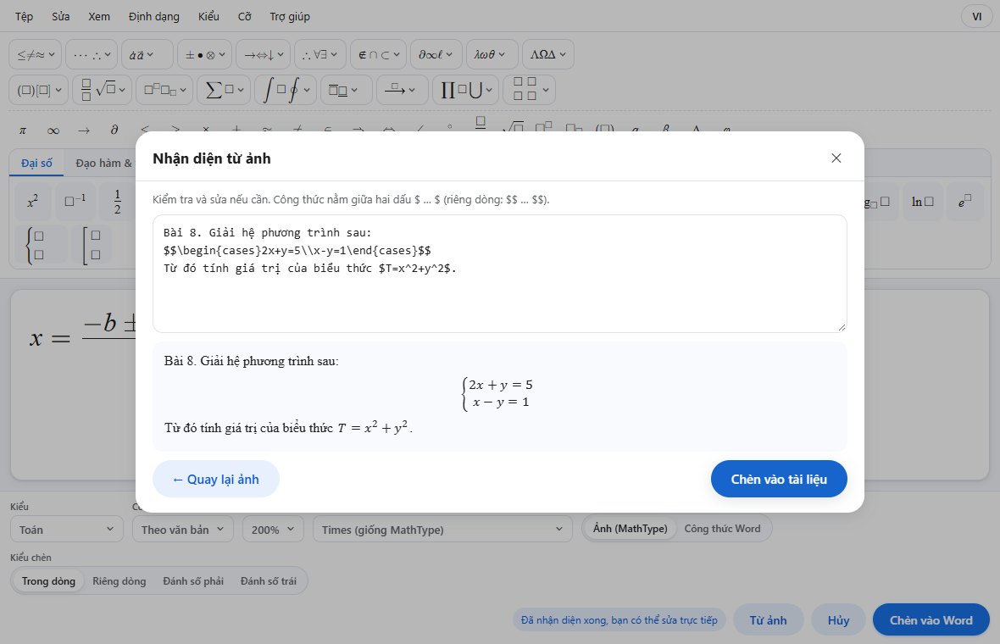
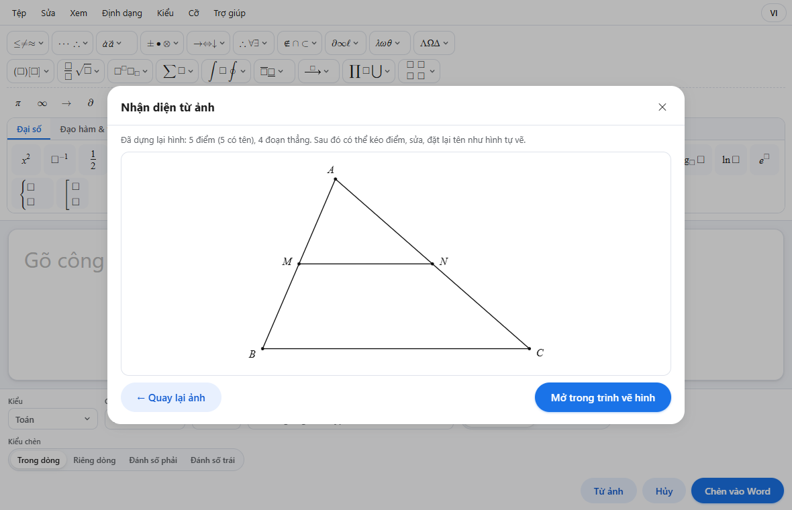

# Hướng dẫn sử dụng MathStudio

MathStudio giúp thầy cô và các em soạn tài liệu Toán ngay trong Word:

- **Công thức** đẹp như sách giáo khoa, sửa lại được bất cứ lúc nào, gõ giống MathType.
- **Hình học**: vẽ hình phẳng, hình khối, dựng hình từ đề bài, có hình mẫu theo từng lớp.
- **Nhận diện từ ảnh**: chụp hoặc chép ảnh công thức, đề bài, hình vẽ → thành công thức và hình sửa được.

Chưa cài? Xem [Cài đặt MathStudio](CAI-DAT.md).

**Mục lục**

1. [Tab MathStudio trên Word](#1-tab-mathstudio-trên-word)
2. [Soạn công thức](#2-soạn-công-thức)
3. [Sửa, đổi dạng, đánh số công thức](#3-sửa-đổi-dạng-đánh-số-công-thức)
4. [Vẽ hình học](#4-vẽ-hình-học)
5. [Dựng hình từ đề bài](#5-dựng-hình-từ-đề-bài)
6. [Nhận diện từ ảnh](#6-nhận-diện-từ-ảnh)
7. [Chuyển đổi với MathType](#7-chuyển-đổi-với-mathtype)
8. [Phím tắt](#8-phím-tắt)
9. [Mẹo và câu hỏi thường gặp](#9-mẹo-và-câu-hỏi-thường-gặp)

---

## 1. Tab MathStudio trên Word

Sau khi cài, Word có thêm tab **MathStudio** với các nhóm nút:

| Nhóm | Nút | Dùng để |
|---|---|---|
| **Chèn công thức** | Trong dòng | Công thức nằm giữa dòng chữ, ví dụ: *biết x² + 1 = 5* |
| | Riêng dòng | Công thức căn giữa, đứng một dòng riêng |
| | Đánh số phải / Đánh số trái | Công thức riêng dòng có số thứ tự (1), (2)… |
| | Từ ảnh | Nhận diện công thức, đề bài hoặc hình vẽ từ ảnh |
| **Công thức** | Sửa công thức | Mở lại công thức (hoặc hình) đang đặt con trỏ để sửa |
| | Chuyển TeX | Đổi qua lại giữa công thức và mã `$…$` |
| | Đổi dạng | Đổi công thức giữa dạng ảnh (giống MathType) và công thức Word |
| | Cập nhật số | Đánh lại số thứ tự các công thức có đánh số |
| **Hình học** | Vẽ hình | Mở trình vẽ hình |
| | Sửa hình | Mở lại hình đang chọn để sửa |
| **Chuyển đổi** | MathType ⇄ | Chuyển công thức MathType sang MathStudio và ngược lại |
| **Trợ giúp** | Hướng dẫn | Mẹo, phím tắt, tải phông chữ toán |

---

## 2. Soạn công thức

### Mở trình soạn

1. Đặt con trỏ ở chỗ cần chèn trong tài liệu.
2. Bấm **Trong dòng** (công thức giữa dòng chữ) hoặc **Riêng dòng** (công thức đứng riêng, căn giữa).
3. Cửa sổ soạn công thức hiện ra.

### Gõ công thức

Gõ thẳng bằng bàn phím, MathStudio tự hiểu nhiều cách gõ quen thuộc:

| Gõ | Được |
|---|---|
| `x^2` | x² |
| `a_1` | a₁ |
| `1/2` | phân số ½ |
| `sqrt` | căn bậc hai |
| `alpha`, `pi`, `Delta` | α, π, Δ |
| `<=`, `>=`, `!=` | ≤, ≥, ≠ |
| `sin x`, `log`, `lim` | hàm số viết đứng, đúng quy ước |

Hoặc dùng **thanh ký hiệu và mẫu** phía trên (giống MathType): bấm một nút để chèn phân số, căn, ngoặc, tích phân, ma trận, hệ phương trình… Những ô vuông nhỏ là chỗ cần điền: bấm **Tab** để sang ô kế tiếp.

Các **tab bên dưới thanh mẫu** (Đại số, Đạo hàm & tích phân, Thống kê, Ma trận, Tập hợp, Lượng giác, Hình học) gom sẵn các mẫu hay dùng theo chương trình Việt Nam.

### Chèn vào Word

- Bấm **Chèn vào Word** (hoặc **Ctrl + S**).
- Muốn bỏ: bấm **Hủy** (hoặc **Esc**; nếu đã gõ, bấm Esc lần nữa để xác nhận).

### Các lựa chọn ở thanh dưới cùng

| Mục | Ý nghĩa |
|---|---|
| **Kiểu** | Toán, Văn bản, Hàm, Biến, Hy Lạp, Vectơ – ma trận, Số (như MathType) |
| **Cỡ chữ** | *Theo văn bản* (bằng cỡ chữ của đoạn đang gõ) hoặc chọn cỡ cố định |
| **Thu phóng** | Phóng to vùng soạn cho dễ nhìn (không ảnh hưởng cỡ trong Word) |
| **Phông toán** | *Times (giống MathType)* là mặc định; có STIX Two Math, TeX Gyre Termes, Latin Modern, Cambria Math |
| **Dạng** | **Ảnh (MathType)**: hiện giống hệt trên mọi máy, kể cả máy chưa cài phông · **Công thức Word**: công thức gốc của Word |
| **Kiểu chèn** | Trong dòng / Riêng dòng / Đánh số phải / Đánh số trái |

Lựa chọn **Dạng** được nhớ cho những lần sau.

### Chế độ đơn giản cho các em nhỏ

Menu **Xem → Chế độ đơn giản (cho học sinh nhỏ)**: giao diện ít nút, chữ to, các nhóm ký hiệu bằng hình (số, phép tính, phân số, so sánh…). Bấm lại để trở về giao diện đầy đủ.

### Một số thao tác khác

- **Tệp → Sao chép mã LaTeX / Sao chép MathML**: lấy mã của công thức để dán nơi khác.
- **Xem → Mã LaTeX**: xem và sửa trực tiếp mã LaTeX.
- **Xem → Bàn phím ảo**: bàn phím toán trên màn hình (hợp với màn hình cảm ứng).
- **Trợ giúp → Phím tắt** (hoặc **F1**): bảng phím tắt đầy đủ.
- Nút **VI / EN** góc trên phải: đổi ngôn ngữ giao diện.

### Lỡ đóng mất cửa sổ khi chưa chèn?

MathStudio tự lưu công thức đang soạn. Lần mở trình soạn sau sẽ hiện dòng **"Có công thức đang soạn dở chưa chèn vào Word"** → bấm **Khôi phục**.

---

## 3. Sửa, đổi dạng, đánh số công thức

### Sửa công thức đã chèn

- **Windows**: **nhấp đúp** vào công thức.
- Hoặc đặt con trỏ vào công thức (hay bấm chọn công thức dạng ảnh) rồi bấm **Sửa công thức** (Ctrl + Alt + E trên Windows).

Sửa xong bấm **Cập nhật vào Word** (Ctrl + S). Công thức Word gốc (gõ bằng Insert → Equation) cũng sửa được bằng MathStudio: chọn công thức đó rồi bấm Sửa công thức.

### Đổi dạng ảnh ↔ công thức Word

Chọn công thức → **Đổi dạng**. Dùng khi:

- gửi tài liệu cho người **chưa cài** phông STIX: chọn dạng **ảnh** để hiện đúng ở mọi máy;
- cần chỉnh trực tiếp bằng công cụ của Word: chọn dạng **công thức Word**.

### Công thức có số thứ tự

- Chèn bằng **Đánh số phải** hoặc **Đánh số trái**: số được đánh tự động theo thứ tự trong tài liệu.
- Sau khi thêm, xóa hoặc di chuyển công thức có số, bấm **Cập nhật số** để đánh lại.

### Chuyển TeX

- Gõ trong tài liệu `$x^2+1$` (hoặc `$$…$$` cho công thức riêng dòng), bôi đen, bấm **Chuyển TeX** → thành công thức.
- Đặt con trỏ vào công thức, bấm **Chuyển TeX** → thành mã `$…$` (để sửa nhanh bằng chữ).

---

## 4. Vẽ hình học

### Mở trình vẽ hình

Đặt con trỏ ở chỗ cần chèn hình → bấm **Vẽ hình**.

> Nếu bôi đen một **đề bài** trước khi bấm Vẽ hình, MathStudio đọc đề và dựng hình luôn (xem [mục 5](#5-dựng-hình-từ-đề-bài)). Nếu chọn một **ảnh hình vẽ** trong tài liệu, MathStudio nhận diện và dựng lại hình đó (xem [mục 6](#6-nhận-diện-từ-ảnh)).

### Màn hình trình vẽ

- **Thanh công cụ bên trái**: các nhóm công cụ **Cơ bản**, **Đường**, **Quan hệ**, **Tam giác**, **Tứ giác & đa giác**, **Đường tròn**, **Góc & ký hiệu**, **Hình khối (3D)**, **Không gian (lớp 11–12)**, **Biến hình**, **Khác**. Bấm vào nhóm để chọn công cụ cụ thể.
- **Thanh trên cùng**:
  - **Hình mẫu & đề bài**: hình vẽ sẵn theo lớp và chức năng gõ đề ra hình.
  - **Từ ảnh**: dựng hình từ ảnh.
  - **Dành cho**: chỉ hiện công cụ của một lớp (Lớp 2 … Lớp 10+) cho gọn, hoặc *Tất cả công cụ*.
  - **SGK Việt Nam / Quốc tế**: kiểu ký hiệu và cách trình bày.
  - **Số đo góc**: cách hiện số đo (60°, 60°30′…).
  - **Nét com-pa**: giữ lại cung com-pa khi dựng hình (như dựng trên giấy).
  - **Lưới**, **Hệ trục**: hiện lưới ô vuông, hệ trục tọa độ.
- **Bên phải**: **Thuộc tính** của đối tượng đang chọn và danh sách **Đối tượng**.
- **Thanh dưới**: Hoàn tác, Làm lại, Phóng to/Thu nhỏ, **Vừa khung**, **Thước kẻ**, **Ê-ke**, **Thước đo góc**, Chọn hết, Nhân bản, **Kích thước khi chèn**, **Chú thích "Hình n"**.

### Vẽ

1. Chọn công cụ, đọc dòng hướng dẫn ở dưới (ví dụ *"Nhấp đỉnh thứ nhất"*).
2. Nhấp lên vùng vẽ theo hướng dẫn. Công cụ cần số liệu (độ dài, số đo góc…) sẽ hiện ô nhập với các giá trị hay dùng.
3. Điểm mới tự được đặt tên A, B, C… và tự bắt dính vào điểm, đường, lưới có sẵn.

Một vài công cụ hay dùng:

| Muốn vẽ | Công cụ |
|---|---|
| Đoạn thẳng có độ dài cho trước, đường thẳng, tia, đường vuông góc, song song, trung trực, tia phân giác | nhóm **Đường** |
| Tam giác vuông, cân, đều; tam giác biết 3 cạnh / 2 cạnh và góc xen giữa; đường cao, trung tuyến, phân giác, đường trung bình, trọng tâm, trực tâm, đường tròn ngoại tiếp / nội tiếp | nhóm **Tam giác** |
| Hình chữ nhật, hình vuông, hình bình hành, hình thoi, hình thang, đa giác đều | nhóm **Tứ giác & đa giác** |
| Đường tròn (tâm và điểm / tâm và bán kính / qua 3 điểm), tiếp tuyến, cung, hình quạt | nhóm **Đường tròn** |
| Ký hiệu góc, góc vuông, vẽ góc có số đo cho trước, ký hiệu bằng nhau, hiện số đo | nhóm **Góc & ký hiệu** |
| Hình hộp, lập phương, lăng trụ, hình chóp, trụ, nón, cầu (có nét khuất) | nhóm **Hình khối (3D)** |
| Hình chóp, tứ diện, lăng trụ, hộp để dựng tiếp: giao điểm, giao tuyến, thiết diện, hình chiếu | nhóm **Không gian (lớp 11–12)**, xem [Hình không gian](#hình-không-gian-lớp-1112) |
| Đối xứng trục, đối xứng tâm, phép quay, tịnh tiến, vị tự | nhóm **Biến hình** |
| Chia hình thành phần bằng nhau và tô màu (phân số lớp 2–5) | **Chia phần và tô màu** (nhóm Tứ giác & đa giác) |
| Trục số, đồ thị hàm số, chữ trên hình | nhóm **Khác** |

### Hình không gian (lớp 11–12)

Nhóm **Không gian (lớp 11–12)** vẽ hình chóp (đáy tam giác, tứ giác, hình bình hành, hình thang; chóp đều; cạnh bên vuông góc với đáy), tứ diện, lăng trụ, hình hộp, lập phương theo đúng cách vẽ của SGK. Các điểm có vị trí thật trong không gian nên dựng tiếp được:

| Muốn dựng | Công cụ (nhấp lần lượt) |
|---|---|
| Trung điểm, trọng tâm, điểm chia cạnh theo tỉ số (ví dụ SM = 2MA) | **Trung điểm (không gian)**, **Trọng tâm tam giác (không gian)**, **Điểm chia đoạn theo tỉ số** (nhấp vào cạnh) |
| Nối hai điểm (phần bị che tự vẽ nét đứt) | **Nối hai điểm (không gian)** |
| Giao điểm của hai đường thẳng cùng nằm trong một mặt phẳng | **Giao điểm hai đường thẳng**: 4 điểm |
| Giao điểm của đường thẳng và mặt phẳng | **Giao điểm của đường thẳng và mặt phẳng**: 2 điểm, rồi 3 điểm của mặt phẳng |
| Giao tuyến của hai mặt phẳng, ví dụ (SAC) và (SBD) | **Giao tuyến của hai mặt phẳng**: 3 điểm, rồi 3 điểm |
| Thiết diện của hình cắt bởi mặt phẳng (MNP) | **Thiết diện**: nhấp vào hình, rồi M, N, P. Thiết diện được tô màu, các đỉnh mới tự đặt tên |
| Đường song song, hình chiếu của điểm lên mặt phẳng / đường thẳng | **Đường song song cắt một đường**, **Hình chiếu vuông góc lên mặt phẳng**, **Hình chiếu vuông góc lên đường thẳng** |

Thanh trượt **Xoay hình** ở trên vùng vẽ quay cả hình để nhìn rõ hơn: nét khuất tự đổi thành nét đứt theo góc nhìn mới; **Như SGK** đưa về góc nhìn quen thuộc. Kéo một điểm trên cạnh thì điểm trượt dọc cạnh đó.

Cũng có thể gõ đề, ví dụ: *Cho hình chóp S.ABCD có đáy ABCD là hình bình hành tâm O. Gọi M là trung điểm của SC. Tìm giao tuyến của (SAC) và (SBD). Tìm giao điểm I của AM và (SBD).* Phần trả lời (giao tuyến, giao điểm I) được đánh dấu **Thuộc đáp án**, nên bản Đề không có lời giải. Tab **Hình mẫu theo lớp** có sẵn vài hình không gian hay gặp.

### Sửa hình đang vẽ

- **Kéo điểm** để thay đổi hình: mọi thứ dựng từ điểm đó (trung điểm, đường cao…) tự đi theo.
- **Chọn một đối tượng** (công cụ Di chuyển) → bảng Thuộc tính bên phải: **Đổi tên**, **Nét đứt**, **Số đo**, **Bằng nhau**, màu, kiểu điểm… Tên gõ `A_1` thành A₁, `x^2` thành x².
- **Chọn nhiều**: kéo khung trên nền trống (hoặc Ctrl + A). Nắm trong khung để dời cả nhóm; thanh phía trên để **xoay, lật, phóng to**; phím mũi tên để dịch nhẹ; **Delete** để xóa.
- **Kéo tên điểm** để đặt tên ở chỗ khác.
- Cuộn chuột để di chuyển vùng nhìn, **Ctrl + cuộn chuột** để phóng to.

### Bản Đề và bản Đáp án

Đánh dấu các nét là **Thuộc đáp án** (trong Thuộc tính): khi chèn **bản Đề**, các nét đó được bỏ đi. Mẹo: chèn bản Đề, sao chép hình, sửa bản sao và chọn **Đáp án** để có hình lời giải.

### Chèn vào Word

- **Kích thước khi chèn**: 50% … 200%.
- **Chú thích "Hình n"**: thêm dòng *Hình 1, Hình 2…* dưới hình, tự đánh số.
- Bấm **Chèn vào Word** (Ctrl + S).

Hình chèn vào là ảnh nét đẹp, in rõ, và **mở lại sửa được**: nhấp đúp vào hình (Windows) hoặc chọn hình rồi bấm **Sửa hình**. Hình vẫn sửa được kể cả sau khi đã kéo sang chỗ khác trong tài liệu.

Lỡ đóng trình vẽ khi chưa chèn: lần mở sau bấm **Khôi phục** ở dòng *"Có hình vẽ dở chưa chèn vào Word"*.

---

## 5. Dựng hình từ đề bài

1. Trong trình vẽ hình: **Hình mẫu & đề bài → Gõ đề bài**.
2. Gõ hoặc dán đề, ví dụ:
   *Cho tam giác ABC vuông tại A có AB = 3 cm, AC = 4 cm. Kẻ đường cao AH. Gọi M là trung điểm của BC.*
3. Hình hiện ngay bên phải khi gõ. Mỗi câu của đề có dấu cho biết đã vẽ được (✓) hay chưa.
4. Câu chưa hiểu: MathStudio gợi ý cách viết lại; bấm gợi ý để dùng. Bật **Ghi nhớ cách viết** để lần sau tự hiểu cách viết đó.
5. Bỏ tích một câu nếu không muốn vẽ phần đó. Câu hỏi (*Chứng minh…*, *Tính…*) được bỏ qua.
6. Bấm **Đưa vào hình vẽ** → chỉnh thêm nếu cần → **Chèn vào Word**.

Những phần đề chưa vẽ tự động được hiện ở mục **Việc còn lại**: bấm tên công cụ để vẽ tay, đánh dấu khi xong.

Cách nhanh hơn: **bôi đen đề bài trong Word** (kể cả có công thức MathType) rồi bấm **Vẽ hình**.

Tab **Hình mẫu theo lớp** có sẵn các hình hay gặp từ lớp 2 đến lớp 10: bấm để đưa vào rồi sửa tiếp.

---

## 6. Nhận diện từ ảnh

Biến ảnh (ảnh chụp sách, đề thi, ảnh quét, ảnh chụp màn hình, ảnh có sẵn trong tài liệu) thành nội dung **sửa được**. Mọi xử lý diễn ra ngay trên máy, ảnh không được gửi đi đâu và không được lưu lại.

### Đưa ảnh vào

- Bấm **Từ ảnh** (trên tab MathStudio, trong trình soạn công thức, hoặc trong trình vẽ hình), rồi:
  - **dán ảnh** bằng Ctrl + V, hoặc
  - **kéo thả** ảnh vào khung, hoặc
  - bấm **Chọn ảnh…**.
- Hoặc **chọn một ảnh trong tài liệu** rồi bấm **Từ ảnh** (công thức, đề bài) hay **Vẽ hình** (hình vẽ): ảnh được đưa vào luôn.
- Dán ảnh thẳng vào trình soạn công thức hay trình vẽ hình cũng mở chức năng này.

**Kéo chuột trên ảnh** để chỉ đọc một vùng (ví dụ chỉ một công thức trong cả trang).

### Chọn loại nội dung

| Chọn | Kết quả |
|---|---|
| **Một công thức** | Công thức hiện ngay trong trình soạn, sửa rồi chèn như công thức tự gõ |
| **Cả đề bài (chữ + công thức)** | Đoạn văn có công thức. Kiểm tra trong ô kết quả: công thức nằm giữa `$ … $` (riêng dòng: `$$ … $$`), có xem trước bên dưới; công thức nên xem lại được **tô vàng**. Bấm **Chèn vào tài liệu**: chữ thành chữ, mỗi công thức thành công thức MathStudio sửa được |
| **Hình vẽ** | Hình được dựng lại thành hình động: điểm có tên, đoạn thẳng (liền/đứt), số đo trên cạnh, ký hiệu góc vuông, cạnh bằng nhau, vùng tô màu… Bấm **Mở trong trình vẽ hình** (hoặc **Đưa vào hình vẽ**) để kéo, sửa, đặt tên lại rồi chèn |

**Một công thức**: công thức nhận được hiện ngay trong trình soạn.

**Cả đề bài**: kiểm tra, sửa nếu cần, rồi chèn.

**Hình vẽ**: hình được dựng lại, có tên điểm, sửa được.

Trong trình vẽ hình, chọn **Cả đề bài** rồi **Vẽ hình theo đề này** để dựng hình từ đề trong ảnh.

### Để nhận diện tốt

- Ảnh **chụp thẳng**, đủ sáng, chữ rõ nét. Ảnh hơi nghiêng vẫn đọc được.
- Chữ **in** (sách, đề in). Chữ viết tay chưa được hỗ trợ.
- Ảnh trang có nhiều thứ: kéo chọn đúng vùng cần đọc.
- Hình vẽ: chữ không đè lên nét vẽ thì đọc tên điểm tốt hơn.
- Ảnh chụp đồ vật, phong cảnh không phải hình vẽ: MathStudio sẽ báo và không dựng hình.

Lần đầu dùng, MathStudio cần tải bộ nhận diện (khoảng 50 MB) nên chờ lâu hơn một chút; những lần sau dùng ngay, kể cả khi không có mạng.

**Luôn kiểm tra lại kết quả** trước khi dùng: nhận diện tự động có thể sai một vài ký hiệu (ví dụ chữ A nghiêng đọc thành số 4).

---

## 7. Chuyển đổi với MathType

Bấm **MathType ⇄**, khung bên phải hiện ra:

- **Chuyển từ MathType**: mọi công thức MathType trong tài liệu được chuyển sang MathStudio (chọn dạng *Ảnh (giống MathType)* hoặc *Công thức Word*). Kết quả **mở thành tài liệu mới**, tài liệu gốc giữ nguyên. Không cần cài MathType.
- **Chuyển sang MathType** (cho người nhận dùng MathType):
  - *Thành công thức Word* → sau đó dùng MathType ▸ Convert Equations;
  - *Thành mã $TeX$* → sau đó dùng MathType ▸ Toggle TeX.

---

## 8. Phím tắt

### Trong Word (Windows, khi công cụ MathStudio đang chạy ở khay hệ thống)

| Phím | Việc |
|---|---|
| Ctrl + Alt + Q | Công thức trong dòng |
| Alt + Q | Công thức riêng dòng |
| Alt + Shift + Q | Công thức đánh số phải |
| Ctrl + Alt + Shift + Q | Công thức đánh số trái |
| Ctrl + Alt + E | Sửa công thức / hình đang chọn |
| Nhấp đúp | Sửa công thức / hình |

Tắt tạm thời: nhấp chuột phải biểu tượng MathStudio ở khay hệ thống → bỏ chọn *Bật phím tắt MathStudio*.

### Trong trình soạn công thức (giống MathType)

| Phím | Việc |
|---|---|
| Ctrl + F | Phân số |
| Ctrl + / | Phân số gạch chéo |
| Ctrl + R | Căn bậc hai |
| Ctrl + T, N | Căn bậc n |
| Ctrl + H / Ctrl + L / Ctrl + J | Chỉ số trên / dưới / cả hai |
| Ctrl + 9 hoặc Ctrl + 0 | Ngoặc tròn |
| Ctrl + [ / Ctrl + { / Ctrl + \| | Ngoặc vuông / ngoặc nhọn / giá trị tuyệt đối |
| Ctrl + I | Tích phân |
| Ctrl + T, S / Ctrl + T, L | Tổng / giới hạn |
| Ctrl + T, M / Ctrl + T, C | Ma trận 2×2 / hệ phương trình |
| Ctrl + Shift + − / Ctrl + Alt + − | Gạch trên / vectơ |
| Ctrl + G rồi một chữ | Chữ Hy Lạp (a→α, b→β, p→π, q→θ, D→Δ…) |
| Ctrl + K rồi một phím | Ký hiệu (I→∞, T→×, + →±, < →≤, > →≥, / →≠…) |
| Ctrl + Shift + E / = / F / I / B | Kiểu văn bản / toán / hàm / biến / vectơ |
| Tab / Shift + Tab | Sang ô kế tiếp / ô trước |
| Ctrl + S | Chèn (cập nhật) vào Word và đóng |
| Esc | Đóng trình soạn |
| F1 | Bảng phím tắt |

### Trong trình vẽ hình

| Phím | Việc |
|---|---|
| Ctrl + Z / Ctrl + Y | Hoàn tác / làm lại |
| Ctrl + A | Chọn hết |
| Ctrl + C / Ctrl + V / Ctrl + D | Sao chép / dán / nhân bản |
| Delete | Xóa đối tượng đang chọn |
| Phím mũi tên (Shift + mũi tên) | Dịch đối tượng 0,1 cm (1 cm) |
| Enter | Khép kín đa giác, kết thúc đường gấp khúc |
| Esc | Bỏ thao tác đang làm / về công cụ Di chuyển / đóng |
| Ctrl + S | Chèn vào Word |

---

## 9. Mẹo và câu hỏi thường gặp

**Gửi tài liệu cho người khác, công thức có bị lỗi không?**
Công thức dạng **Ảnh** hiện giống hệt ở mọi máy. Công thức dạng **Công thức Word** cần máy kia có phông STIX Two Math (cài MathStudio là có); nếu không, Word thay bằng Cambria Math, vẫn đọc được. Người nhận không cần MathStudio để xem hay in.

**Người nhận có sửa được không?**
Có, nếu họ cài MathStudio. Công thức dạng Công thức Word còn sửa được bằng công cụ Equation sẵn có của Word.

**In ra có đẹp không?**
Có. Công thức và hình dùng hình vector, in sắc nét ở mọi cỡ.

**Công thức hiện chữ hơi khác trên máy khác?**
Máy đó chưa có phông toán: cài MathStudio trên máy đó, tải phông ở **Hướng dẫn → Phông chữ toán**, hoặc đổi công thức sang dạng Ảnh.

**Không thấy tab MathStudio, hoặc nút không phản hồi?**
Xem mục *Gặp vấn đề* trong [Cài đặt MathStudio](CAI-DAT.md#gặp-vấn-đề).

**Nhận diện ảnh báo "phiên bản Word chưa hỗ trợ"?**
Cần Word mới (Microsoft 365 hoặc Office 2021 trở lên).

**Báo lỗi, góp ý, đề xuất tính năng**: tạo mục mới ở trang [Issues](https://github.com/hoangtuananhk56/MathStudio/issues) của dự án. Gửi kèm ảnh chụp màn hình và mô tả các bước sẽ giúp sửa nhanh hơn.
